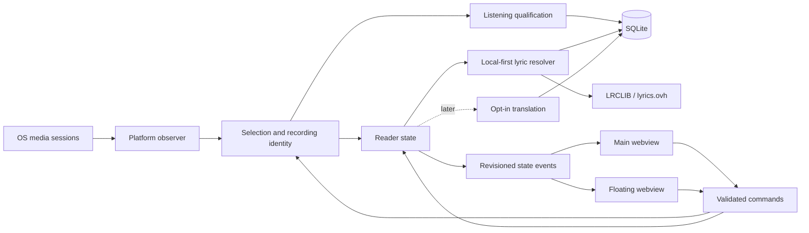

# Desktop architecture

Status: stack and product boundaries confirmed; detailed interfaces remain implementation proposals. See [confirmed scope](09-confirmed-release-scope.md) and [decisions](07-decisions.md). No implementation is claimed.

## Confirmed stack and boundaries

Use Tauri 2 with a Rust application core, SQLite persistence, and React + TypeScript + Vite for presentation. This stack was confirmed by the user. Pin mutually compatible stable toolchain/dependency versions during P1 and commit lockfiles; do not infer versions from the Android build.

Keep one Rust process authoritative for collection and persisted state. Both main and floating webviews subscribe to it. Rust owns platform observers, player selection, identity, listening qualification, lookup, translation, database, backups, selected-root file access and window lifecycle. TypeScript owns layout, reader rendering, accessible controls, card composition/rendering and temporary editor input. Validating and saving an editor draft belongs in Rust.

Use a small Rust workspace with a platform-independent `singalong-core` crate and a Tauri shell. This lets core tests run without a window server. Avoid a generic plugin framework for every feature; a few explicit ports are sufficient.

Alternatives considered:

| Approach | Benefit | Cost / decision |
| --- | --- | --- |
| Rust core + TypeScript UI | One owner for windows, native IO and transactional behavior | Selected; domain rules must be ported and tested |
| TypeScript domain + thin Rust bridge | Less Rust application code; easier browser feature reuse | Multi-window ownership and background lifecycle become harder; not preferred |
| Kotlin shared JVM core alongside Tauri | Potential algorithm reuse | Adds JVM/sidecar packaging and lifecycle complexity; not recommended for this port |

Local browser tests can use a fixture bridge; no public demo/browser edition is in scope. Translation services, editing, cards and folder scanning below describe later modules, not stable requirements. The stable core still preserves their imported data.

## Proposed repository layout

```text
AGENTS.md
README.md
package.json
package-lock.json
vite.config.ts
src/
  app/                     navigation, runtime construction
  bridge/                  typed native transport and local test fixture adapter
  features/
    now/                   live and saved reader presentation
    collection/            library/history/search/favorites
    editor/                text and timing drafts
    settings/
    cards/                 composition and PNG renderer
  overlay/                 floating reader entrypoint
  shared/                  tokens, accessible controls, presentation helpers
src-tauri/
  Cargo.toml
  Cargo.lock
  tauri.conf.json
  capabilities/            main and overlay grants
  permissions/             custom command permission definitions
  src/
    lib.rs                 construction only
    commands/              validated IPC surface
    runtime/               coordinator, jobs, revisions, shutdown
    platform/              windows.rs, linux.rs, macos.rs, mock.rs
    storage/               repository, migrations, transaction worker
    providers/             HTTP, cooldowns, network policy, translation
    files/                 selected-root scanning and import/export
    windows/               overlay geometry, tray and lifecycle
    diagnostics/
  crates/singalong-core/
    src/                   model, identity, selection, qualification,
                           parsing, matching, timing, edits, backup model
    tests/
  migrations/
tests/
  fixtures/                synthetic parity cases and Android-format archives
  integration/
  e2e/
plan/                      planning and implementation evidence; never deployed
  README.md
docs/
  README.md
  [future site assets]
dist/                      ignored packaged-web build output
artifacts/                 ignored local test/build evidence
```

Directories and filenames are planned, not claims that files exist. Keep modules small by responsibility; split further only when implementation needs it.

## Runtime data flow



A user selecting a library song opens a saved-reading context; it must not replace the tracked live recording or increment history. A card draft captures an immutable content snapshot. Editor and restore commits emit a library revision and refresh affected readers.

## Model and IPC contract

Port Recording, PlaybackSnapshot, LyricLine, LyricWord, LyricVersion, TranslationRecord, version selections and adjustments with explicit units. Preserve null/unknown position and duration rather than converting them to zero. Keep provider timing distinct from display-only estimates.

Replace Android packageName with `PlayerId { platform, nativeId }`; separate a persistent player identity from an ephemeral session identity. Do not assume two browser tabs are distinguishable if the OS groups their sessions. Model selection as Automatic, AppPin or StreamPin, with an explicit waiting state. Persist app pins; restore stream targets only with verified identity. Unavailable pins do not clear themselves or fall back. Automatic selection retains paused ownership until stop/disappearance. Eligibility always requires an enabled app.

Define serialized DTOs in Rust and generate TypeScript declarations (or validate both against the same schema). Use tagged enums for playback, lookup and job states. Use camelCase for JSON fields and explicit Android enum/field mappings in the compatibility codec.

A proposed event envelope is:

```ts
type Revision = string; // decimal u64; avoid JS integer precision loss
interface StateEvent<T> {
  schema: 1;
  revision: Revision;
  generation: string;
  payload: T;
}
interface CommandFailure {
  code: "invalid_input" | "unsupported" | "permission_denied" |
        "offline" | "rate_limited" | "storage_unavailable" | "cancelled";
  message: string;
  retryAfterMs?: number;
}
```

Commands are requests to the single owner, not direct UI writes to SQLite. Planned groups:

| Group | Requests | Outputs |
| --- | --- | --- |
| Runtime | get snapshot, start/stop tracking, list/allow players, choose session | Current state and capability report |
| Reader | retry lookup, select version, follow, set delay, align line, opt into estimates | Revisioned reader state |
| Library | paginated query, favorite, clear history/downloads | Entries and mutation result |
| Editor | import preview, save new version, validate/stamp timing | Draft preview or committed version |
| Jobs | start/cancel folder scan, preview/apply restore, export backup | Opaque job ID and progress/result |
| Translation | enable after consent, resolve opened version, external handoff | Partial/complete state or handoff result |
| Windows | show/hide/minimize/resize overlay, reset position | Authoritative panel state |
| Export | choose image, save rendered card, export diagnostic | Bounded asset token or result |

Before implementing each group, define concrete request/response types in that task. Long jobs return promptly with an ID; cancellation is idempotent, and a stopped generation cannot commit a later result. Mutating commands accept only validated IDs/settings, never SQL, arbitrary shell text or unbounded paths/URLs.

Subscribe before requesting the initial snapshot, then reconcile revisions so a startup event is not lost. Reconnect/reload gets a full snapshot. Reject events from old generations. Large library pages/lyric contents are fetched on selection rather than broadcast each frame.

## Clocks, concurrency and window consistency

Use a monotonic Rust clock for observation/qualification. Normalize external timestamps at adapter boundaries. Never subtract Rust `Instant` values from browser `performance.now()` directly. Send a position anchored at emission; the UI anchors it to its own receipt time for smooth presentation and accepts subsequent correction snapshots. Backend alignment/stamp commands use the authoritative backend position.

Listen to OS events plus bounded reconciliation polling where needed. Re-anchor on seek, pause, track change, sleep/resume and disconnected sessions. Attempt a native refresh before deciding a quiet session is stale. If position cannot be verified, freeze synchronization, show Playback position unavailable, and keep manual reading; do not extrapolate indefinitely. Reset the qualification interval across unobserved sleep rather than counting it as listening.

Keep callback registrations scoped to adapter lifetime. A serialized coordinator handles selection and identity, and a database worker serializes transactions off the UI thread. Network and metadata decoding are cancellable jobs. Coalesce high-frequency events without dropping stop/seek/track-change transitions.

The two readers have independent scroll positions and follow state modelled by reader-context ID. Global track/version/offset and overlay mode remain single-owner state. This is a deliberate refinement of Android's shared reader: document the context contract before P4 so UI controls do not fight.

## Desktop interaction and accessibility

Use a persistent sidebar or compact navigation rail for Now, Library and Settings. A separate History screen comes later. Provide a resizable reader/detail area and keyboard-operable options. When cards are implemented later, translate long-press card creation into a context menu plus a visible action. Keep an explicit return-to-live action when browsing a saved song.

Use semantic HTML, labelled icon buttons, visible focus, scalable text, reduced-motion handling and strong readable contrast over transparent backgrounds. Preserve full accessible lyric text even when word spans animate. Avoid announcing every interpolation frame. Render only visible long-list rows with stable line IDs; screen-reader mode must still expose a usable reading order.

Overlay controls must wrap and remain reachable at minimum size and 200% scaling. Prefer a readable solid fallback when blur/transparency is unavailable. Keep appearance independent for Now and floating. Pixel-perfect imitation of mobile chrome is not a parity requirement.

## Stable lifecycle and policy

Closing main hides it to the tray; explicit Quit terminates all work. Restore previously enabled tracking and app pin on launch. Windows sign-in startup is off by default and launches to the tray when enabled. Automatic overlay display is a distinct opt-in; manual hiding wins. Include optional click-through and guaranteed tray recovery.

Fetch for opened readers immediately; background-save lyrics after ten seconds of observed playing even while hidden. Use any connection by default, with Offline mode cancelling provider work. Preserve Android possible-match labels, conservative filename hints, estimates and version-specific offsets. Library browsing must not redirect the live overlay.

## Security and native boundaries

Use bundled local app assets in production, not the Pages URL. Scope plugin capabilities separately for main and overlay. Tauri's docs note that custom registered commands are broadly available by default: define custom command permissions and/or verify caller labels explicitly. Overlay must not gain backup, arbitrary file access or network privileges through shared capability membership. See [Tauri capabilities](https://v2.tauri.app/security/capabilities/).

Native dialogs return opaque scoped handles owned by Rust. Resolve and validate paths at use time; reject directory escapes and symlink traversal outside a selected root. Artwork from media sessions is untrusted input: validate source, size, decoding and track identity. Do not fetch arbitrary remote art merely because a player provides a URL.

Use a restrictive CSP, escaped text rendering and allowlisted external HTTPS links. No remote script, HTML lyrics, general shell command bridge or user-selected file origin may gain Tauri privileges.

SQLite in the per-user app-data directory is the local source of truth. Settings in the same database can make desktop restore atomic; secrets, if ever needed, require a separate OS credential-store decision.
